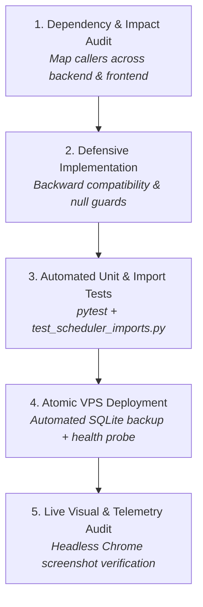

# NSE Trading Desk: Complete Architecture, System Map & Zero-Regression Workflow

> **Current Production Server**: `104.168.91.147` (`https://nseuniverse.duckdns.org`)  
> **Master Database**: SQLite Single Master Vault at `/var/lib/nse-tradingdesk/swing_trades.db`  
> **Cloud Backup**: Telegram Cloud Master Vault (`core/telegram_cloud_vault.py`)  
> **Status**: ONLINE / OPERATIONAL (All 21 Core Service Endpoints Active & Verified)

---

## 1. Zero-Regression Engineering Protocol

To guarantee that new features never break existing modules or cause visual flickers/data loss, **every code change must adhere to the 5-Step Quality Gate**:



### Pre-Change Checklist
1. **API Contract Verification**: Ensure response keys are never renamed or removed without frontend deprecation handling.
2. **Database Integrity**: Never drop tables or delete columns. Always use `CREATE TABLE IF NOT EXISTS` and `ALTER TABLE ADD COLUMN` with try/except guards.
3. **Frontend DOM Guarding**: Never perform repeated unconstrained `element.innerHTML` mutations in tight streaming loops (`pollContinuousKotakStream` / WebSocket). Always use equality checks (`if (el.innerHTML !== newHtml)`) and unified state controllers.
4. **Symbol & Import Verification**: Run `pytest tests/test_scheduler_imports.py` to ensure zero undefined symbols or missing imports across the entire repository.
5. **Live Verification**: Run automated endpoint health probe and capture headless Chrome screenshots of affected tabs before marking a task complete.

---

## 2. Platform Architecture & Functional Module Map

```
┌─────────────────────────────────────────────────────────────────────────────────────────────┐
│                                     NSE TRADING DESK                                        │
├─────────────────┬───────────────────┬───────────────────┬───────────────────┬───────────────┤
│  Swing Trading  │  Intraday Expiry  │   Options Desk    │  Predictions ML   │ MCX Commodity │
│   (3 Portfolios)│     (15m/30m)     │    (Weekly/Mo)    │  (Pre-Market/AI)  │ (Crude/Gold)  │
└────────┬────────┴─────────┬─────────┴─────────┬─────────┴─────────┬─────────┴───────┬───────┘
         │                  │                   │                   │                 │
┌────────▼────────┐┌────────▼─────────┐┌────────▼─────────┐┌────────▼─────────┐┌───────▼───────┐
│6-Pillar & N500  ││15m Slot Telemetry││Full Option Chain ││Pre-Market Forecast││MCX Live Quotes│
│Broad Screener   ││OI Flow & Straddle││Iron Condor/Hedge ││Macro Economic Cal││Options Chain  │
│Trailing SL (ATR)││GEX, Gamma & ORB  ││Adjustments Engine││Brier Calibration ││Depth & OBI    │
│Telegram Vault   ││ML Slot Direction ││Strategy Modal UAT││US Correlation    ││Strategy Deploy│
└─────────────────┘└──────────────────┘└───────────────────┘└───────────────────┘───────────────┘
```

---

## 3. Comprehensive Module & Function Directory

### A. Swing Trading Hub (`?module=swing`)
- **Portfolio 1: Institutional 6-Pillar Engine**:
  - `engines/institutional_engine.py`: Runs 6-pillar technical indicator vectorization (Trend, Momentum, Volatility, Volume, Structure, ML Percentile).
  - `engines/screener_comparison_engine.py`: Evaluates all **2,351** NSE listed 'EQ' equities dynamically. Filters ~**786** passing candidate stocks based on turnover ($\ge 1\text{ Cr}$), price ($> 75$), ROCE/ROE ($\ge 10\%$), and positive PAT.
  - **Dynamic Telemetry Bar**: Real-time 5-card counter:
    - `Total NSE Stocks` (2,351)
    - `Passing Screener` (786)
    - `BUY NOW`
    - `PULLBACK` (`PRE_BREAKOUT` + `WAIT_PULLBACK`)
    - `AVOID`
  - **Incremental OHLCV Gap Fill**: Synchronizes with Telegram Cloud Vault first, downloads only intraday delta candles.
  - **Trailing Stops & Exits**: Ratchets stops higher on ATR multiples; executes exits only when criteria are breached.
- **Portfolio 2: Nifty 500 Momentum Engine**:
  - `engines/nifty500_momentum_engine.py`: Momentum ranking, 4-tier exit hierarchy (trailing stop, time stop, trend reversal, target).
- **Portfolio 3: Pre-Breakout & Squeeze Engine**:
  - `engines/pre_breakout_engine.py`: Identifies volatility compression and Bollinger Band squeeze setups before expansion.
- **Core Endpoints**:
  - `GET /api/portfolio/{portfolio_type}/summary`
  - `GET /api/portfolio/{portfolio_type}/positions`
  - `GET /api/portfolio/{portfolio_type}/history`
  - `POST /api/scan/trigger`
  - `GET /api/scan/progress`
  - `GET /api/screener/compare/summary`

---

### B. Intraday Weekly Expiry Desk (`?module=intraday`)
- **15-Minute Slot Capture Pipeline**:
  - `engines/intraday_options_strategy_engine.py`: Captures 25 discrete intraday market slots (09:15 to 15:30 IST) at 15m intervals into `intraday_options_snapshots`.
  - Computes exact ATM Straddle Premium decay, Near-ATM PCR, Overall PCR, Put Wall, Call Wall, and Max Pain.
- **Unified Anti-Flicker Controller**:
  - `updateIntradaySpotAtmCard(spot, atm, isLive, diffStr, slotNote)`: Controls `intra-kpi-spot` and `intra-kpi-spot-sub`.
  - Prevents stream polls from overriding `MARKET CLOSED` status during post-market hours.
  - Retains daily change (`ΔDay: -123.7 (-0.54%)`) and closing slot telemetry (`Slot 15:30: ₹22687.7`).
- **Real-Time Technical Gauges**:
  - `VWAP & ORB`: 15m and 30m Opening Range Breakout boundaries with distance-from-spot tracking.
  - `Gamma Exposure (GEX)`: Total net GEX and Zero-Gamma flip level (indicates whether market makers stabilize or amplify volatility).
  - `Sector Breadth`: 7 key sectors (Bank, IT, Auto, Pharma, FMCG, Metal, Energy) tracking drag vs lift.
  - `Level-2 Depth & OBI`: Real-time Kotak Neo bid/ask depth, micro-price, and order book imbalance.
  - `Intraday ML Model`: Slot-trained directional classifier ($P(\text{Up})$, $P(\text{Flat})$, $P(\text{Down})$) with writer bias scoring.
- **Core Endpoints**:
  - `GET /api/nifty/intraday-expiry?interval=15m`
  - `GET /api/nifty/intraday-advanced`
  - `GET /api/nifty/intraday-ml`
  - `GET /api/nifty/intraday/order-flow`
  - `POST /api/nifty/intraday-expiry/capture`

---

### C. Options Desk VTX (`?module=options`)
- **Option Chain & Pricing**:
  - `engines/nifty_analytics_engine.py`: Fetches official NSE option chain with Kotak Neo live tick overlays across all weekly and monthly expiries.
  - Computes Black-Scholes Greeks ($\Delta, \Gamma, \Theta, \mathcal{V}$), IV, and strike-level liquidity.
- **Strategies & Risk Management**:
  - Deploys defined-risk strategies (Iron Condors, Iron Butterflies, Bull Put Spreads, Bear Call Spreads).
  - `engines/options_adjustment_engine.py`: Recommends defensive adjustments (rolling challenged wings) when delta bounds are tested.
- **Trade History & Detail Modal**:
  - Displays closed options strategies with strike legs, entry/exit timestamps, entry credits, exit debits, and verified PnL.
- **Core Endpoints**:
  - `GET /api/nifty/options-chain?expiry_type=weekly`
  - `GET /api/nifty/options-chain?expiry_type=monthly`
  - `GET /api/options/portfolio`
  - `POST /api/options/deploy-strategy`
  - `POST /api/options/adjust-strategy`
  - `POST /api/options/exit-strategy`

---

### D. Predictions & AI Intelligence (`?module=predictions`)
- **Pre-Market & Macro Intelligence**:
  - `engines/nifty_forecast_learning_system.py`: Generates pre-market directional predictions combining global cues (US S&P, Nasdaq, Crude, US 10Y yields, GIFT Nifty) with technical structure.
  - Projects central bank calendars (US Fed FOMC & RBI MPC) with expected volatility impact.
- **Core Endpoints**:
  - `GET /api/ai/analysis`
  - `GET /api/ai/status`
  - `POST /api/ai/analyze`
  - `GET /api/calendar`

---

### E. Commodities Desk (`?module=mcx`)
- **MCX Crude Oil, Gold, Silver & Natural Gas**:
  - `engines/commodities_engine.py`: Live MCX commodity tracking, option chains, term structures, and directional setups.
- **Core Endpoints**:
  - `GET /api/commodities/summary`
  - `GET /api/commodities/quotes`
  - `GET /api/commodities/options/chain`

---

### F. Core Services, Database & Automation
- **Database Engine (`execution/state_engine.py`)**:
  - Single Master SQLite File (`data/swing_trades.db` / `/var/lib/nse-tradingdesk/swing_trades.db`).
  - Thread-safe connection pools, WAL mode, synchronous=NORMAL, transactions wrapped with locks.
  - Tables: `active_positions`, `trade_history`, `latest_signals`, `ohlcv_master_store`, `intraday_options_snapshots`, `nse_listed_equities_master`, `system_kv_store`.
- **Scheduler (`scheduler/cron_scheduler.py`)**:
  - `09:15–15:30 IST`: Continuous 15m slot captures.
  - Every 30 minutes: Automated In-House Screener scan across all NSE stocks.
  - Daily at `16:00 IST`: Master SQLite database backup & sync to Telegram Cloud Vault.
  - Every 5 minutes: Kotak Neo token refresh & health watchdog.

---

## 4. Live Health Check Directory (21 Core Services)

| # | Service Name | Endpoint Route | Status | Response Telemetry |
|---|--------------|----------------|--------|---------------------|
| 1 | Health Check | `/health` | **200 OK** | `status=ok` |
| 2 | System Status | `/api/status` | **200 OK** | `status=ONLINE` (19 system keys) |
| 3 | Nifty Live Spot | `/api/nifty/live-spot` | **200 OK** | Live price, day change, prev close |
| 4 | Kotak Neo Stream | `/api/stream/continuous` | **200 OK** | Live WebSocket ticks + market hours gate |
| 5 | Intraday Expiry (15m) | `/api/nifty/intraday-expiry?interval=15m` | **200 OK** | 25 slots, straddle, PCR, walls |
| 6 | Intraday Advanced | `/api/nifty/intraday-advanced` | **200 OK** | GEX, ORB, Sector breadth |
| 7 | Intraday ML Model | `/api/nifty/intraday-ml` | **200 OK** | Direction probabilities, writer bias |
| 8 | Options Chain (Weekly)| `/api/nifty/options-chain?expiry_type=weekly` | **200 OK** | Full strikes, Greeks, IV |
| 9 | Options Chain (Monthly)| `/api/nifty/options-chain?expiry_type=monthly` | **200 OK** | Full monthly contracts |
| 10 | Options Portfolio | `/api/options/portfolio` | **200 OK** | Active strategies, Greeks, live PnL |
| 11 | Portfolio 1 Summary | `/api/portfolio/PORTFOLIO_1/summary` | **200 OK** | 5-card screener telemetry (2,351 / 786) |
| 12 | Portfolio 1 Positions | `/api/portfolio/PORTFOLIO_1/positions` | **200 OK** | Active holdings, trailing stops |
| 13 | Portfolio 1 History | `/api/portfolio/PORTFOLIO_1/history?limit=5` | **200 OK** | Verified closed trades with full PnL |
| 14 | Portfolio 2 Summary | `/api/portfolio/PORTFOLIO_2/summary` | **200 OK** | Nifty 500 momentum portfolio |
| 15 | Portfolio 3 Summary | `/api/portfolio/PORTFOLIO_3/summary` | **200 OK** | Squeeze / Pre-breakout portfolio |
| 16 | Screener Dual Audit | `/api/screener/compare/summary` | **200 OK** | In-House vs Chartink parity audit |
| 17 | Screener Presets | `/api/screener/presets` | **200 OK** | EQ-FINAL, Momentum, Breakout filters |
| 18 | Scan Progress Queue | `/api/scan/progress` | **200 OK** | Multi-threaded execution queue status |
| 19 | ML System Overview | `/api/ml/overview` | **200 OK** | Model accuracy, Brier scores |
| 20 | Commodities Summary | `/api/commodities/summary` | **200 OK** | MCX contract status & summary |
| 21 | Commodities Quotes | `/api/commodities/quotes` | **200 OK** | Real-time commodity bid/ask ticks |

---

## 5. Standard Deployment & Verification Runbook

When deploying updates to production:

```bash
# 1. Run local tests
pytest tests/test_custom_screener.py tests/test_scheduler_imports.py -q

# 2. Commit and push to main
git add <modified_files>
git commit -m "feat/fix(...): description"
git push origin main

# 3. Deploy to VPS
ssh root@104.168.91.147 "/usr/local/bin/deploy-nse-tradingdesk"

# 4. Probe live endpoints
python scripts/audit_all_endpoints.py

# 5. Visual verification screenshot
powershell -ExecutionPolicy Bypass -File scripts/take_verification_screenshots.ps1
```
