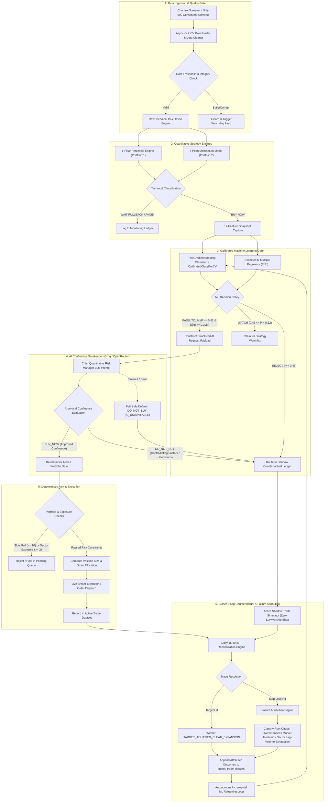
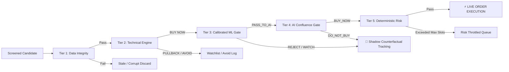

# 🏛️ Quant Trading Desk — Institutional NSE Multi-Engine Platform

[](https://www.python.org/)
[](https://fastapi.tiangolo.com/)
[](https://www.sqlite.org/)
[](https://scikit-learn.org/)
[](https://groq.com/)
[]()

Institutional-grade, autonomous quantitative trading system engineered for the **National Stock Exchange of India (NSE)**. The platform features an end-to-end multi-tier decision pipeline where deterministic quantitative models scan and select candidates, calibrated machine learning meta-classifiers estimate outcome probabilities and expected risk multiples, an AI confluence gatekeeper conducts final buy authorizations, and a deterministic risk engine governs portfolio capital allocation and trade execution.

The system runs 24/7 on a dedicated Linux VPS with real-time data watchdog telemetry, automated Market-On-Close (MOC) hot database backups, shadow counterfactual tracking with zero survivorship bias, and closed-loop failure attribution for continuous self-learning.

---

## 📑 Table of Contents

1. [Executive Summary & Core Architecture](#-executive-summary--core-architecture)
2. [End-to-End System Diagrams](#-end-to-end-system-diagrams)
3. [Multi-Tier Buy Decision Gatekeeper](#-multi-tier-buy-decision-gatekeeper)
4. [Machine Learning Engine & Governance](#-machine-learning-engine--governance)
5. [AI Confluence Gatekeeper (Groq & OpenRouter)](#-ai-confluence-gatekeeper-groq--openrouter)
6. [Shadow Counterfactual Ledger & Failure Attribution](#-shadow-counterfactual-ledger--failure-attribution)
7. [Dual Swing Portfolios (Mathematical Specifications)](#-dual-swing-portfolios-mathematical-specifications)
8. [Intraday & 0-DTE Options Strategy Desk](#-intraday--0-dte-options-strategy-desk)
9. [Daily Nifty Macro Forecasting Engine](#-daily-nifty-macro-forecasting-engine)
10. [Central Data Watchdog & SLA Monitoring](#-central-data-watchdog--sla-monitoring)
11. [Master Daily Schedule & IST Execution Timeline](#-master-daily-schedule--ist-execution-timeline)
12. [Market-On-Close (MOC) Daily Backup & Cloud Vault](#-market-on-close-moc-daily-backup--cloud-vault)
13. [Complete REST API Reference (All Endpoints)](#-complete-rest-api-reference-all-endpoints)
14. [Dedicated 24/7 VPS Production Deployment](#-dedicated-247-vps-production-deployment)
15. [Local Development & Testing](#-local-development--testing)

---

## 🔭 Executive Summary & Core Architecture

Traditional retail trading algorithms suffer from two catastrophic pitfalls:
1. **Survivorship & Selection Bias**: Backtests and ML models only learn from accepted trades, remaining blind to setups that were filtered out but could have performed well, or setups that barely passed and failed miserably.
2. **Hallucinatory or Unconstrained AI Execution**: Relying entirely on Large Language Models for trade generation produces fabricated numbers, hallucinated support levels, and uncalibrated risk.

**Quant Trading Desk solves this through a strict separation of concerns:**
* **Technical Engines Select**: Deterministic rule engines scan hundreds of NSE stocks, calculate 30+ raw indicators across 6 quantitative pillars, and classify stocks into `BUY NOW`, `WAIT PULLBACK`, and `AVOID`.
* **Calibrated ML Evaluates**: A `HistGradientBoostingClassifier` calibrated via `CalibratedClassifierCV(method='sigmoid')` alongside an Expected R Regressor evaluates the 17-dimensional feature vector. It predicts the exact probability $P(\text{Target}_1 \text{ before Stop})$ and expected $R$-multiple $E[R]$.
* **AI Decides Final Confluence**: Groq (`openai/gpt-oss-120b`) or OpenRouter (`nvidia/nemotron-3-nano-omni-30b-a3b-reasoning:free`) receives a comprehensive JSON evidentiary payload (market context, technical indicators, ML probabilities, trade plan, and historical base rates). It acts as the Chief Risk Manager to authorize `BUY_NOW` or reject with `DO_NOT_BUY`.
* **Deterministic Risk Engine Controls**: Even if AI approves, the trade cannot execute unless portfolio capacity (max 10 slots), sector concentration limits (max 2 per sector), and capital allocation budgets are strictly respected.
* **Shadow Counterfactual Ledger Learns**: Every rejected candidate is tracked in a shadow simulator with tick-by-tick or EOD candle resolution. When stops or targets are hit, an automated failure attribution engine categorizes the failure mode (`MARKET_REGIME_HEADWIND`, `OVEREXTENDED`, `VOLUME_EXHAUSTION`, `SECTOR_LAG`) and feeds genuine counterfactual results back into the retraining dataset.

---

## 📊 End-to-End System Diagrams

### 1. High-Level Multi-Tier Gatekeeper & Execution Pipeline



### 2. Multi-Tier Buy Decision Gatekeeper Logic Flow



### 3. Dedicated 24/7 VPS System Architecture

```mermaid
flowchart TD
    subgraph RackNerd_VPS ["RackNerd KVM VPS (Ubuntu 24.04 LTS — 104.168.91.147)"]
        Service["systemd: nse-tradingdesk.service (Python 3.12 / FastAPI)"]
        CronDaemon["APScheduler Background Daemon (IST Timezone)"]
        
        subgraph Storage_Layer ["Persistent Storage Engine"]
            MainDB["/var/lib/nse-tradingdesk/swing_trades.db (SQLite WAL Mode)"]
            Symlink["/opt/nse-tradingdesk/data/swing_trades.db (Symlink)"]
            Symlink --> MainDB
            DailyBackupDir["/var/backups/nse-tradingdesk/daily/ (14-Day Rolling Hot Snapshots)"]
        end
        
        subgraph Schedulers ["Automated Cron Triggers"]
            J1["08:45 IST: Pre-Market Forecast Lock"]
            J2["08:55 IST: Dynamic NSE Holiday Sync"]
            J3["09:15–15:30 IST: 5m Tick & 15m Options Telemetry"]
            J4["10:20 IST: Morning Swing Scan (P1)"]
            J5["15:00 IST: Afternoon MOC Swing Scan (P1 & P2)"]
            J6["15:15 IST: Intraday Options Mandatory Square-Off"]
            J7["15:40 IST: Nifty Forecast & ML Self-Training"]
            J8["15:45 IST: Market-On-Close SQLite Hot Backup"]
        end
        
        CronDaemon --> J1 & J2 & J3 & J4 & J5 & J6 & J7 & J8
        Service --> MainDB
        J8 --> DailyBackupDir
    end

    subgraph External_Integrations ["External Gateways & Cloud Vault"]
        NSE["NSE India Live Portals"]
        YF["Yahoo Finance API"]
        Groq["Groq API (openai/gpt-oss-120b)"]
        OpenRouter["OpenRouter API (nvidia/nemotron-3-nano)"]
        Telegram["Telegram Cloud Vault Channel"]
        Cloudflare["Cloudflare Zero-Trust Quick Tunnel"]
    end

    Service <--> Groq & OpenRouter
    Service <--> NSE & YF
    DailyBackupDir -. Encrypted Sync .-> Telegram
    Service <--> Cloudflare
    Cloudflare <--> User["Web Browser / Mobile PWA / Terminus SSH"]
```



---

## 🛡️ Multi-Tier Buy Decision Gatekeeper

Every potential swing trade passes through a mandatory 5-tier evaluation funnel:

```
[Candidate Ingestion] ➡️ [Technical Classification] ➡️ [ML Gatekeeper] ➡️ [AI Confluence Gate] ➡️ [Deterministic Risk] ➡️ [Execution]
```

### Tier 1: Candidate Ingestion & Data Quality
* Screened from the configured Chartink scanners or official Nifty 500 constituent lists.
* Source timestamp validation: OHLCV bars are verified for zero look-ahead bias, minimum 200 trading days history, and absence of synthetic padding.
* If candle data is stale ($> 24$ hours on trading days) or volume is 0, candidate is flagged `INVALID_OR_STALE_DATA` and discarded.

### Tier 2: Quantitative Technical Engine
* Computes 30+ technical indicators across Trend, Momentum, Volatility, Volume, Sector RS, and Proximity.
* Maps candidates into one of three deterministic buckets:
  * `BUY NOW`: Immediate technical breakout or confirmed pullback pattern. Eligible for ML evaluation.
  * `WAIT PULLBACK`: Strong trend but stretched from support. Monitored for retracement; zero immediate buying.
  * `AVOID`: Weak structural trend, negative sector momentum, or declining volume. Logged and excluded.

### Tier 3: Calibrated Machine Learning Gate
* Extracts the exact 17-dimensional entry-time feature vector.
* Runs `HistGradientBoostingClassifier` calibrated with sigmoid `CalibratedClassifierCV` to obtain calibrated probability $P(\text{Win})$.
* Runs Expected Return regressor to obtain $E[R]$.
* Applies the strict decision contract:
  * `PASS_TO_AI`: $P(\text{Win}) \ge 0.52$ and $E[R] \ge +0.30R$.
  * `WATCH`: $0.45 \le P(\text{Win}) < 0.52$. Candidate is kept in an observation watchlist.
  * `REJECT`: $P(\text{Win}) < 0.45$. Candidate is blocked from purchase and routed to the Shadow Counterfactual Ledger.
  * `INSUFFICIENT_DATA`: Missing feature inputs or short historical lookback. Blocked from purchase.

### Tier 4: AI Confluence Gatekeeper
* Structured JSON request submitted to the LLM (Groq `openai/gpt-oss-120b` or OpenRouter fallback).
* LLM reviews full evidentiary bundle: technical metrics, ML win probability, Expected R, reward-to-risk ratio, market regime, sector momentum, and historical setup base rates.
* Returns structured JSON: `BUY_NOW` or `DO_NOT_BUY` with explicit reasoning code.
* **Fail-Safe Protocol**: If all AI providers time out or fail, the system automatically defaults to `DO_NOT_BUY` with `AI_UNAVAILABLE`. Under no circumstances is a candidate purchased without active AI concurrence.

### Tier 5: Deterministic Risk & Capital Management
* Validates maximum slot capacity (max 10 open positions).
* Validates sector concentration limits (max 2 positions per sector).
* Computes exact share quantity using portfolio risk budget (0.60% to 1.50% depending on setup tier).
* Ensures required cash is available in the portfolio ledger.

---

## 🧠 Machine Learning Engine & Governance

The swing ML engine (`engines/swing_quant_ml_engine.py`) provides disciplined probabilistic inference rather than naive rule-based scoring.

### 17-Dimensional Entry-Time Feature Schema

| Feature Name | Type | Domain / Bounds | Description |
| :--- | :--- | :--- | :--- |
| `score` | `float` | $[0.0, 100.0]$ | 6-Pillar composite technical score |
| `confidence` | `int` | $[1, 6]$ | Setup confidence level based on confluence criteria met |
| `rsi14` | `float` | $[0.0, 100.0]$ | 14-period Wilder Relative Strength Index |
| `atr_pct` | `float` | $[0.0, 20.0]$ | 14-period ATR expressed as a percentage of entry price |
| `dist_to_pivot` | `float` | $[-10.0, 25.0]$ | Percentage distance to nearest 50-day pivot resistance |
| `dist_to_ema20` | `float` | $[-10.0, 20.0]$ | Percentage distance of price above/below 20-day EMA |
| `vol_ratio` | `float` | $[0.0, 15.0]$ | Day's volume divided by 50-day volume SMA (RVOL) |
| `inst_score` | `float` | $[0.0, 100.0]$ | Institutional footprint score (delivery proxy + volume surge) |
| `week_confluence`| `int` | $\{0, 1\}$ | Binary indicator: Weekly 20 EMA > Weekly 50 SMA |
| `is_vcp` | `int` | $\{0, 1\}$ | Volatility Contraction Pattern detected (Minervini) |
| `bb_sq_ratio` | `float` | $[0.0, 2.0]$ | Bollinger Band Squeeze ratio (Bandwidth / 20-day average) |
| `adx14` | `float` | $[0.0, 100.0]$ | Average Directional Index (Trend strength) |
| `nifty_ret_5d` | `float` | $[-15.0, 15.0]$ | Nifty 50 benchmark 5-day percentage return |
| `nifty_rsi14` | `float` | $[0.0, 100.0]$ | Nifty 50 benchmark 14-period RSI |
| `vix_val` | `float` | $[5.0, 50.0]$ | India VIX spot value at entry time |
| `sector_excess_6m`| `float` | $[-30.0, 30.0]$ | Sector index 6-month excess return vs Nifty 50 |
| `rr_ratio` | `float` | $[1.0, 10.0]$ | Reward-to-Risk ratio: $(\text{Target}_1 - \text{Entry}) / (\text{Entry} - \text{SL})$ |

### Model Architecture & Mathematical Training Objective
* **Target Definition**: Binary target $y \in \{0, 1\}$
  $$y = \begin{cases} 1 & \text{if price reaches Target 1 (+1.5R) before Stop Loss within 15 holding days} \\ 0 & \text{if price hits Stop Loss or expires at a loss within 15 holding days} \end{cases}$$
* **Probability Classifier**: `HistGradientBoostingClassifier(max_iter=150, min_samples_leaf=20, l2_regularization=1.0)` wrapped in `CalibratedClassifierCV(method='sigmoid', cv=3)`.
* **Expected R Regressor**: `Ridge(alpha=10.0)` or `HistGradientBoostingRegressor` predicting continuous realized $R$-multiple.
* **Expected Value Formulation**:
  $$\text{EV} = P(\text{Win}) \times R_{\text{Target}} - (1 - P(\text{Win})) \times 1.0R - \text{Friction}$$
  Candidates are only passed when $\text{EV} \ge +0.30R$.

---

## 🤖 AI Confluence Gatekeeper (Groq & OpenRouter)

The AI Intelligence Orchestrator (`ai_engine/service.py`) acts as the Chief Quantitative Risk Manager.

### Provider Hierarchy & Active Model Configuration

```
[Primary: Groq (openai/gpt-oss-120b)]
       │ (On rate-limit / network error)
       ▼
[Secondary: Groq (openai/gpt-oss-20b)]
       │ (On provider failure)
       ▼
[Tertiary: OpenRouter (nvidia/nemotron-3-nano-omni-30b-a3b-reasoning:free)]
       │ (On total failure)
       ▼
[Fail-Safe Default: DO_NOT_BUY (Reason: AI_UNAVAILABLE)]
```

### AI Decision Reason Codes

```python
class SwingReasonCode(str, Enum):
    APPROVED_CONFLUENCE               = "APPROVED_CONFLUENCE"               # High technical, ML, and market alignment
    INSUFFICIENT_RISK_REWARD          = "INSUFFICIENT_RISK_REWARD"          # R:R < 1.5 or unfavorable reward skew
    CONFLICTING_TECHNICALS            = "CONFLICTING_TECHNICALS"            # Bearish divergences or volume churn
    ML_EVIDENCE_INSUFFICIENT          = "ML_EVIDENCE_INSUFFICIENT"          # Calibrated probability or Expected R too low
    EXCESSIVE_VOLATILITY              = "EXCESSIVE_VOLATILITY"              # ATR % too wide or India VIX > 18
    PORTFOLIO_EXPOSURE_LIMIT          = "PORTFOLIO_EXPOSURE_LIMIT"          # Sector or asset class overconcentration
    INVALID_OR_STALE_DATA             = "INVALID_OR_STALE_DATA"             # Discrepancy in candle timestamps or quotes
    STRATEGY_CONDITIONS_NOT_SATISFIED = "STRATEGY_CONDITIONS_NOT_SATISFIED" # Failed entry confirmation rules
    MISSING_REQUIRED_INFO             = "MISSING_REQUIRED_INFO"             # Critical feature missing in snapshot
    AI_UNAVAILABLE                    = "AI_UNAVAILABLE"                    # Network timeout / missing credentials
    OTHER                             = "OTHER"
```

### JSON Request & Response Schemas

#### Structured Request to AI:
```json
{
  "schema_version": "1.0",
  "request_id": "req_RELIANCE_20261016_102000",
  "candidate": {
    "symbol": "RELIANCE",
    "exchange": "NSE",
    "scanner_source": "Chartink Institutional 6-Pillar",
    "current_price": 2845.50,
    "technical_engine": {
      "score": 87.5,
      "confidence": 5,
      "classification": "BUY NOW",
      "rsi14": 58.4,
      "dist_to_ema20_pct": 1.8,
      "vol_ratio": 2.15,
      "sector": "OIL & GAS",
      "sector_excess_6m": 4.2
    },
    "ml_engine": {
      "model_version": "hist_gb_calibrated_v1.2",
      "calibrated_win_probability": 0.68,
      "expected_r": 0.65,
      "decision": "PASS_TO_AI"
    },
    "trade_plan": {
      "entry_price": 2845.50,
      "stop_loss": 2760.00,
      "target_1": 2973.75,
      "target_2": 3102.00,
      "risk_per_share": 85.50,
      "reward_to_risk": 1.50
    },
    "market_context": {
      "nifty_trend": "BULLISH",
      "nifty_5d_return_pct": 1.25,
      "vix_spot": 13.80
    }
  }
}
```

#### Structured Response from AI:
```json
{
  "schema_version": "1.0",
  "request_id": "req_RELIANCE_20261016_102000",
  "status": "success",
  "candidate_id": "cand_RELIANCE_1020",
  "symbol": "RELIANCE",
  "final_decision": "BUY_NOW",
  "reason_code": "APPROVED_CONFLUENCE",
  "summary": "Setup exhibits ideal pullback discipline to 20 EMA with 2.15x RVOL institutional absorption. Calibrated ML win probability of 68% and healthy +1.5R skew justify execution with benign India VIX regime.",
  "supporting_factors": [
    "Composite score of 87.5/100 with RSI in optimal 58.4 momentum sweet spot",
    "Volume expansion of 2.15x confirm institutional footprint",
    "Calibrated ML win probability of 68% exceeds 52% hurdle"
  ],
  "contradicting_factors": [],
  "risk_factors": [
    "Overhead resistance near historical 2980 zone"
  ],
  "missing_information": [],
  "conditions_for_reconsideration": [],
  "model_context": {
    "ml_model_version": "hist_gb_calibrated_v1.2",
    "input_snapshot_id": "snap_RELIANCE_20261016"
  }
}
```

---

## 👻 Shadow Counterfactual Ledger & Failure Attribution

To eliminate **survivorship bias**, every candidate rejected by the ML Gate or AI Gate is not discarded. Instead, it is entered into the **Shadow Counterfactual Ledger** (`quant_trade_dataset` with `trade_type = 'SHADOW'`).

### Counterfactual Reconciliation Workflow
1. Every evening at **15:40 IST**, `reconcile_shadow_trades()` checks all active shadow setups against daily high, low, and close prices.
2. If `Day Low <= Stop Loss`: The trade is marked `RESOLVED_STOP_LOSS`. The model learns that its rejection was **correct** (prevented a loss).
3. If `Day High >= Target 1`: The trade is marked `RESOLVED_TARGET`. The model learns that its rejection was **overly conservative** (missed winner).
4. If holding duration reaches 20 days without hitting either boundary: Marked `EXPIRED_TIME`.

### Stop-Loss Failure Attribution Taxonomy
When an active real trade or shadow trade hits its stop loss, the system deterministically attributes the failure to one of seven root causes:

```
                                  Stop Loss Triggered
                                           │
          ┌────────────────────────────────┴────────────────────────────────┐
          ▼                                                                 ▼
[Exogenous Market Driver]                                       [Endogenous Setup Flaw]
  ├── MARKET_REGIME_HEADWIND (Nifty < -1.5% during hold)          ├── OVEREXTENDED_AT_ENTRY (Price > 3.5% from Pivot / >5% from EMA20)
  ├── ELEVATED_VOLATILITY_WHIPSAW (India VIX >= 18.0)             ├── RSI_PEAK_EXHAUSTION (Daily RSI >= 72.0 overbought churn)
  └── SECTOR_ROTATION_HEADWIND (Sector excess < -3.5%)            ├── LOW_VOLUME_FALSE_BREAKOUT (Volume ratio < 1.0x 50 SMA)
                                                                  └── NORMAL_STATISTICAL_STOP_OUT (Clean setup, benign noise)
```

The attributed failure mode is permanently recorded in both `quant_trade_dataset` and `swing_decision_audit`, and fed back into model retraining to automatically penalize similar conditions in future candidates.

---

## 📈 Dual Swing Portfolios (Mathematical Specifications)

The desk operates two distinct, non-correlated quantitative swing strategies:

### 1. Portfolio 1 — Institutional 6-Pillar Percentile Engine

* **Universe**: Liquid mid-cap and large-cap stocks from Chartink fundamental and liquidity screener.
* **Base Capital**: ₹5,00,000.
* **Capacity Limit**: Max 10 concurrent open positions, maximum 2 per industrial sector.

#### 6-Pillar Architecture & Weights:
$$\text{Composite Score} = \sum_{i=1}^{6} w_i \times P_i$$

1. **Trend Pillar (25%)**: Alignment of 20 EMA, 50 SMA, and 200 SMA; ADX(14) $> 25$; positive directional movement (+DI > -DI).
2. **Momentum Pillar (20%)**: RSI(14) in the 50–65 momentum acceleration pocket; expanding MACD histogram above zero; bullish Stochastic %K/%D crossover.
3. **Volatility Pillar (15%)**: ATR(14) contraction; Bollinger Band Squeeze ratio $< 0.80$; Historical Volatility (HV20) compression prior to breakout.
4. **Volume Pillar (15%)**: Relative Volume (RVOL) $> 1.5\times$ 50-day average; institutional accumulation days (pocket pivots); On-Balance Volume (OBV) slope $> 0$.
5. **Sector Relative Strength (15%)**: 20-day and 60-day relative strength of the stock's industry sector benchmark vs the Nifty 50 Index.
6. **Proximity Pillar (10%)**: Distance to 20-day EMA $\le 2.5\%$; distance to 52-week high $\le 15\%$ (Mark Minervini Stage 2 criteria).

#### Score Tiers & Position Sizing:
* **Tier A+ (Score $\ge 85$)**: Risk budget = $1.00\%$ of capital (₹5,000 risk).
* **Tier A (Score $75 - 84$)**: Risk budget = $0.75\%$ of capital (₹3,750 risk).
* **Tier B+ (Score $65 - 74$)**: Risk budget = $0.60\%$ of capital (₹3,000 risk).
* **Score $< 65$**: Filtered out / No purchase permitted.

#### Trade Management & Exit Rules:
* **Stop Loss**: $\min(\text{20-day Low}, \text{Entry} - 1.5 \times \text{ATR}_{14})$ with a hard absolute stop cap of $8.0\%$.
* **Target 1 (+1.5R)**: Book $50\%$ position size; automatically trail stop loss to break-even ($\text{Entry Price}$).
* **Target 2 (+3.0R)**: Book remaining $50\%$ position size, or trail with 5-day low.

---

### 2. Portfolio 2 — Nifty 500 Compounded Momentum Engine

* **Universe**: Official Nifty 500 index constituents.
* **Base Capital**: ₹1,00,000 with dynamic Mark-to-Market equity reinvestment compounding.
* **Risk Budget**: Exactly $1.50\%$ of live compounded equity per position.
* **Slot Limit**: 10 positions maximum (10% capital ceiling per slot).

#### 7-Point Entry Criteria Matrix:
All 7 criteria must evaluate to `TRUE` for candidate qualification:
1. **Macro Regime Gate**: Nifty 500 Index (`^CRSLDX`) is trading above its 50-day EMA.
2. **Structural Uptrend**: Stock's 20-day EMA $> 50$-day SMA, and Close Price $> 50$-day SMA.
3. **Relative Strength Leader**: 60-day Mansfield Relative Strength vs Nifty 500 is strictly positive ($> 0.0$).
4. **Pullback Pocket**: Price is within $0.985$ to $1.020$ of the 20-day EMA.
5. **RSI Cooldown**: 14-period RSI is between $40.0$ and $62.0$ (avoiding overbought exhaustion).
6. **Bullish Bounce Bar**: Daily candle closes in the upper $35\%$ of its high-low range.
7. **Volume Expansion**: Daily volume $\ge 0.80\times$ 20-day volume SMA.

#### 4-Tier Strategy Exit Hierarchy:
Evaluated daily at Market-On-Close (MOC):
* **Priority 1 (Initial Stop Loss)**: Hard stop at $\text{Entry} - 2.0 \times \text{ATR}_{14}$.
* **Priority 2 (Trailing Volatility Lock)**: Once trade reaches $+2.0\text{R}$, trail stop loss to the lowest low of the prior 5 trading days.
* **Priority 3 (Fast Technical Cut)**: Immediate exit if Daily Close falls below the 20-day EMA.
* **Priority 4 (Time-Based Stop)**: Exit at MOC if trade reaches Day 8 without achieving $+1.0\text{R}$.

---

## ⚡ Intraday & 0-DTE Options Strategy Desk

The Options Strategy Engine (`engines/intraday_options_strategy_engine.py` & `engines/weekly_monthly_options_strategy_engine.py`) trades Nifty index derivatives across 5 distinct market regimes.

### Real-Time Options Chain Telemetry
* **Black-Scholes Greeks**: Real-time Delta, Gamma, Theta, and Vega computed per strike.
* **Open Interest Distribution**: Dynamic Put-Call Ratio (PCR), Max Pain strike, Put Open Interest Wall (support floor), and Call Open Interest Wall (resistance ceiling).
* **ATM Straddle Pricing**: Real-time combined ATM CE + PE premium tracking to gauge expected market move.

### 5 Market Regimes & Strategy Matrix

| Market Regime | Detection Rules | Deployed Option Strategy | Exit & Stop Loss Rules |
| :--- | :--- | :--- | :--- |
| **Bullish Trending** | PCR $> 1.25$, Price above VWAP, Gift Nifty $> +0.5\%$ | **Bull Call Spread** (Long ATM CE, Short OTM CE) | Stop: $-40\%$ of debit paid. Target: $+80\%$. |
| **Mild Bullish** | PCR $1.00 - 1.25$, Rangebound with upward bias | **Bull Put Credit Spread** (Sell 0.25 $\Delta$ PE, Buy 0.10 $\Delta$ PE) | Stop: $1.5\times$ credit received. Target: $+75\%$ decay. |
| **Neutral / Rangebound**| PCR $0.85 - 1.15$, Straddle decay $> 10\%$, Low VIX | **Iron Condor / Short Strangle** ($\pm 1.2\sigma$ strikes) | Stop: $1.5\times$ initial spread margin. Target: $+60\%$ decay. |
| **Mild Bearish** | PCR $0.70 - 0.90$, Price below VWAP, Call buildup | **Bear Call Credit Spread** (Sell 0.25 $\Delta$ CE, Buy 0.10 $\Delta$ CE) | Stop: $1.5\times$ credit received. Target: $+75\%$ decay. |
| **High Volatility Bear** | PCR $< 0.70$, India VIX $> 17.0$, Massive PE unwinding | **Bear Put Spread** (Long ATM PE, Short OTM PE) | Stop: $-40\%$ of debit paid. Target: $+80\%$. |

### Strict Intraday Execution Guard
* **Trading Window**: Entries permitted only between 09:30 AM and 01:30 PM IST.
* **Mandatory MOC Square-off (15:15 IST)**: All intraday option legs are automatically squared off at 15:15 PM IST to completely prevent overnight gap risk.

---

## 🔮 Daily Nifty Macro Forecasting Engine

The Nifty Macro Analytics Engine (`engines/nifty_analytics_engine.py`) locks a pre-market directional forecast each morning and evaluates accuracy at market close.

### Ingested Global Macro Datasets
1. **US Markets**: S&P 500 (`^GSPC`), Nasdaq 100 (`^NDX`), Dow Jones (`^DJI`), and Russell 2000 (`^RUT`).
2. **Global Rates & Currencies**: US 10-Year Treasury Yield (`^TNX`), US Dollar Index (`DX-Y.NYB`), and USD/INR.
3. **Commodities**: Brent Crude Oil Futures (`BZ=F`) and Gold Futures (`GC=F`).
4. **Domestic Telemetry**: India VIX, Gift Nifty overnight spread, FII/DII net flows, and Sector Relative Momentum.

### Multi-Horizon Forecast Lock & Evaluation Cycle
* **08:45 AM IST (Pre-Market Lock)**: Ingests overnight feeds, runs directional classifier and range regressor, and computes:
  * Expected T+1 Direction (`BULLISH`, `NEUTRAL`, `BEARISH`).
  * Expected Trading Range: Predicted Day High and Predicted Day Low.
  * Multi-horizon projections: T+1, T+3, and T+5 expected return percentages.
  * Records immutable hash and timestamp in the database; dispatches Telegram Pre-Market Bulletin.
* **15:40 PM IST (EOD Evaluation)**:
  * Compares predicted high, low, and direction against actual NSE cash close.
  * Calculates Directional Accuracy, Range Coverage %, and Mean Absolute Error (MAE).
  * Automatically appends outcome to historical ledger and triggers self-training if rolling 20-day hit rate falls below threshold.

---

## ⏱️ Master Daily Schedule & IST Execution Timeline

The system runs an autonomous cron scheduler (`scheduler/cron_scheduler.py`) synchronized to Indian Standard Time (UTC+5:30):

```
08:45 AM ─── 08:45 AM Official Pre-Market Forecast Lock & Telegram Bulletin
08:55 AM ─── Dynamic NSE Holiday Calendar Sync from nseindia.com
09:00 AM ─── Positional Options Pre-Market Auto-Deploy (Weekly & Monthly)
09:15 AM ─── NSE Market Opens | 5-Minute Live Price Stream Starts
09:30 AM ─── Multi-Interval Nifty Option Chain Telemetry Starts (Every 15m)
09:45 AM ─── Opening Range Breakout (ORB) Flash Bulletin
10:20 AM ─── MORNING INTRADAY SWING SCAN (Portfolio 1 Stage 2 Breakouts & Gap-Check)
11:30 AM ─── Mid-Day Pre-Europe Institutional Review Bulletin
01:30 PM ─── European Open Institutional Velocity Review Bulletin
02:30 PM ─── Final Expiry Decay & Delta Shift Review Bulletin
03:00 PM ─── AFTERNOON MOC SWING SCAN (Portfolio 1 & 2 Execution + 4-Tier Exits)
03:15 PM ─── Intraday 0-DTE Options Mandatory Square-Off Cutoff
03:30 PM ─── NSE Regular Trading Session Closes
03:40 PM ─── EOD Nifty Forecast Evaluation & ML Model Retraining Sync
03:45 PM ─── Market-On-Close SQLite Hot Database Backup & 14-Day Pruning
```

---

## 💾 Market-On-Close (MOC) Daily Backup & Cloud Vault

The backup manager (`core/backup_manager.py`) replaces continuous disk writing with a single, atomic, post-market snapshot.

### Backup Specifications
* **Scheduled Time**: **15:45 PM IST** every trading day (Job 3B: `job_daily_moc_backup_1545`).
* **Online Hot Backup Mechanism**: Uses Python's native `sqlite3.Connection.backup()` to create an ACID-consistent snapshot without locking tables or interrupting active read connections.
* **Verification**: Immediately runs `PRAGMA integrity_check` on the backup file. If any corrupt pages are detected, an alert is raised and the file is marked unverified.
* **Storage Location on VPS**: `/var/backups/nse-tradingdesk/daily/`
* **File Naming Format**: `swing_trades_moc_YYYYMMDD_HHMMSS.db`
* **Retention Policy**: Rolling 14-day retention. Snapshots older than 14 days are automatically pruned.
* **Off-Site Cloud Sync**: The verified snapshot is mirrored to the secure Telegram Cloud Vault channel via Bot API.

---

## 📡 Central Data Watchdog & SLA Monitoring

The Central Data Watchdog (`core/data_gatekeeper.py`) monitors all live telemetry feeds to guarantee zero silent failures.

### Monitored Telemetry Feeds
1. **Intraday Market Streamer**: Live tick updates for active portfolio positions.
2. **Swing EOD Engine**: Daily OHLCV candle updates and Chartink scanner feeds.
3. **Nifty Option Chain**: 15m, 30m, and 50m options chain telemetry.
4. **Daily Forecast Engine**: Pre-market macro intelligence and global indices.

### SLA Latency Thresholds

| Status | Latency Window | System Behavior |
| :--- | :--- | :--- |
| **HEALTHY (Green)** | $\le 120$ seconds | Normal automated execution enabled. |
| **DEGRADED (Amber)** | $120 - 300$ seconds | Warning logged; fallback feeds polled. |
| **ALERT / STALE (Red)**| $> 300$ seconds | Automated order entry throttled; Watchdog alert dispatched. |

* **Interactive Probe**: `POST /api/system/watchdog/probe` performs an immediate forced health ping of all 4 feeds, resetting stalled sockets and refreshing cache headers.

---

## 📚 Complete REST API Reference (All Endpoints)

The FastAPI application (`web/api.py`) exposes 76+ production endpoints:

### 1. System Health & Core

| Method | Endpoint | Description |
| :--- | :--- | :--- |
| `GET` | `/health` | Health check for VPS load balancer and monitoring services |
| `GET` | `/` | Web application home interface (responsive PC & mobile layout) |
| `GET` | `/api/status` | Current system status, live IST clock, and engine status |
| `GET` | `/manifest.json` | Web App Manifest for Progressive Web App (PWA) installation |
| `GET` | `/sw.js` | Service Worker script for offline caching and push notifications |
| `GET` | `/docs` | Interactive Swagger OpenAPI documentation UI |

### 2. AI Intelligence Gatekeeper

| Method | Endpoint | Parameters / Payload | Description |
| :--- | :--- | :--- | :--- |
| `GET` | `/api/ai/status` | — | Returns active AI provider, model IDs, cache size, and API key presence |
| `GET` | `/api/ai/analysis` | — | Returns latest cached natural language interpretation of ML forecasts |
| `POST`| `/api/ai/analyze` | `force_refresh: bool` | Triggers on-demand LLM interpretation of current market context |
| `POST`| `/api/ai/benchmark`| — | Runs latency and quality benchmark across configured Groq and OpenRouter models |

### 3. Machine Learning & Swing Decision Audit

| Method | Endpoint | Parameters / Payload | Description |
| :--- | :--- | :--- | :--- |
| `GET` | `/api/swing/candidate-eval/{symbol}`| `symbol: str` | Evaluates single stock through complete ML + AI gatekeeper with full audit trail |
| `GET` | `/api/swing/decision-audit` | `limit: int = 100` | Returns immutable audit log of all candidate evaluation decisions |
| `GET` | `/api/ml/swing/model-status` | — | Model metadata, feature weights, calibrated Brier score, and accuracy metrics |
| `GET` | `/api/ml/swing/dataset` | `status: str`, `trade_type: str` | Returns historical trade learning dataset (real and shadow trades) |
| `GET` | `/api/ml/swing/shadow-trades` | — | Active shadow trades undergoing counterfactual simulation |
| `POST`| `/api/ml/swing/reconcile-shadow`| — | Triggers EOD audit of shadow trades against latest market prices |
| `POST`| `/api/ml/swing/train` | — | Triggers immediate training of swing ML classifier and expected R regressor |
| `GET` | `/api/ml/swing/active-setups` | — | Active setups with feature vectors being monitored for outcome resolution |

### 4. ML Performance & Governance Dashboard

| Method | Endpoint | Description |
| :--- | :--- | :--- |
| `GET` | `/ml-performance` | Visual ML dashboard interface (confusion matrix, calibration, feature importance) |
| `GET` | `/api/ml/overview` | High-level summary of model versions, training sample counts, and Sharpe ratios |
| `GET` | `/api/ml/dataset-stats` | Distribution of samples across market regimes and holding durations |
| `GET` | `/api/ml-performance/registry` | Registry of all trained model artifacts with rollback checkpoints |
| `GET` | `/api/ml-performance/trade-outcomes`| Realized R-multiples and win rates grouped by ML score deciles |
| `GET` | `/api/ml-performance/regimes` | Model accuracy broken down by Nifty market regime |
| `GET` | `/api/ml-performance/training-history`| Historical validation loss curves and calibration Brier scores |
| `GET` | `/api/ml/trees` | Decision tree visualization data for tree-based models |
| `GET` | `/api/ml/shap` | SHAP feature contribution values for specific predictions |
| `POST`| `/api/ml/retrain` | Triggers retraining across all active machine learning models |
| `POST`| `/api/ml/rollback` | Rolls back the active model to a previous verified checkpoint |

### 5. Swing Portfolios & Execution

| Method | Endpoint | Parameters / Payload | Description |
| :--- | :--- | :--- | :--- |
| `GET` | `/api/portfolio/{type}/summary` | `type: p1 \| p2` | Portfolio equity, cash, active slots, win rate, and profit factor |
| `GET` | `/api/portfolio/{type}/positions` | `type: p1 \| p2` | Open positions with real-time MTM PnL, current price, and stop distances |
| `GET` | `/api/portfolio/{type}/history` | `type: p1 \| p2` | Closed trade audit log with R-multiples, hold days, and exit reasons |
| `GET` | `/api/portfolio/{type}/signals` | `type: p1 \| p2` | Latest screened setups with 6-pillar breakdown and calculated sizing |
| `GET` | `/api/portfolio/equity-curves` | — | Historical mark-to-market equity curves for Portfolio 1 and Portfolio 2 |
| `POST`| `/api/position/open` | `trade_data: dict` | Manually executes a trade entry passing deterministic risk checks |
| `POST`| `/api/position/close` | `trade_id: str` | Manually closes an active position at current market price |
| `POST`| `/api/portfolio/reset` | `portfolio_type: str` | Resets a portfolio ledger to initial base capital |

### 6. Scheduled Scans & Execution Queue

| Method | Endpoint | Parameters / Payload | Description |
| :--- | :--- | :--- | :--- |
| `POST`| `/api/scan/trigger` | `scan_type: str` | Triggers immediate scan (`MORNING_1020AM`, `AFTERNOON_305PM`, `P1`, `P2`) |
| `GET` | `/api/scan/progress` | — | Real-time progress percentage and candidate counts of active scan |
| `GET` | `/api/scan/logs` | `limit: int = 50` | Execution logs, durations, and candidate count telemetry |
| `GET` | `/api/execution/queue` | — | Status of background execution task queue and active worker locks |
| `POST`| `/api/prices/refresh` | — | Forces real-time price refresh for all open positions |

### 7. Daily Database Backup & Telegram Cloud Vault

| Method | Endpoint | Parameters / Payload | Description |
| :--- | :--- | :--- | :--- |
| `POST`| `/api/system/backup/daily` | `retention_days: int = 14` | Triggers immediate MOC hot SQLite backup and integrity verification |
| `GET` | `/api/system/backup/list` | — | Lists all verified daily backup snapshots in `/var/backups/nse-tradingdesk/daily/` |
| `GET` | `/api/vault/status` | — | Telegram Cloud Vault connection status and last cloud sync timestamp |
| `POST`| `/api/vault/sync` | — | Manually uploads the active database to Telegram Cloud channel |
| `POST`| `/api/vault/restore` | `file_id: str` | Restores database from a Telegram Cloud backup file |

### 8. Nifty Macro Forecasting & Predictions

| Method | Endpoint | Description |
| :--- | :--- | :--- |
| `GET` | `/api/nifty/predictions` | Current Nifty directional predictions (T+1 and T+5 horizons) |
| `POST`| `/api/nifty/premarket-forecast/lock`| Manually triggers 08:45 AM pre-market forecast computation and lock |
| `POST`| `/api/nifty/eod-evaluation/run` | Triggers EOD prediction accuracy evaluation against actual close |
| `GET` | `/api/nifty/live-spot` | Real-time Nifty 50 spot price, VWAP, and daily change |
| `GET` | `/api/nifty/minute-chart` | Intraday 1-minute candle chart data for Nifty 50 |
| `GET` | `/api/nifty/us-market-intelligence` | S&P 500, Nasdaq, US 10Y Yield, and Brent Crude telemetry |
| `GET` | `/api/nifty/economic-calendar` | High-impact macroeconomic calendar events (RBI, US Fed, CPI) |
| `GET` | `/api/nifty-forecast/overview` | Forecast historical accuracy, hit rate, and directional bias metrics |
| `GET` | `/api/nifty-forecast/ledger` | Ledger of all locked pre-market forecasts and realized outcomes |

### 9. Intraday & Positional Options Desks

| Method | Endpoint | Description |
| :--- | :--- | :--- |
| `GET` | `/api/nifty/options-chain` | Full option chain with Greeks, OI walls, and ATM straddle premium |
| `GET` | `/api/options/chain-compact` | Compact option chain optimized for mobile bandwidth |
| `GET` | `/api/nifty/intraday-expiry` | 15m, 30m, and 50m interval options telemetry snapshots |
| `POST`| `/api/nifty/intraday-expiry/capture` | Triggers immediate snapshot capture for current time slot |
| `GET` | `/api/options/portfolio` | Open options positions, Greeks exposure, and mark-to-market PnL |
| `POST`| `/api/options/deploy-strategy` | Deploys options strategy (Bull Call, Iron Condor, Bear Put, etc.) |
| `POST`| `/api/options/exit-strategy` | Closes active options strategy and records realized PnL |
| `GET` | `/api/options/intraday-rules/active-trades`| Active trades governed by the 5-regime intraday rule engine |
| `POST`| `/api/options/intraday-rules/auto-deploy`| Evaluates current regime and auto-deploys optimal intraday strategy |
| `GET` | `/api/options/intraday-rules/regime` | Current intraday market regime assessment |
| `GET` | `/api/options/intraday-rules/backtest` | Backtest performance statistics for intraday options regimes |
| `GET` | `/api/options/positional-rules/active-trades`| Active weekly and monthly positional options trades |
| `POST`| `/api/options/positional-rules/auto-deploy`| Evaluates macro regime and auto-deploys positional strategy |
| `GET` | `/api/options/positional-rules/regime`| Positional regime assessment based on weekly/monthly models |
| `GET` | `/api/options/positional-rules/tournament`| Strategy tournament ranking expected returns across options structures |

### 10. Stocks, Watchdog & Market Calendar

| Method | Endpoint | Description |
| :--- | :--- | :--- |
| `GET` | `/api/stocks/fetched` | List of all scanned stocks currently cached in the local store |
| `GET` | `/api/stocks/{symbol}/chart` | OHLCV historical candle data, indicator overlays, and volume profile |
| `POST`| `/api/stocks/{symbol}/reset_chart`| Clears local candle cache and forces clean refetch from data provider |
| `GET` | `/api/system/watchdog` | Real-time SLA latency status across all 4 monitored data feeds |
| `POST`| `/api/system/watchdog/probe` | Forces diagnostic health ping across all data streams |
| `GET` | `/api/calendar` | NSE trading calendar, trading day status, and upcoming market holidays |
| `POST`| `/api/calendar/sync-holidays` | Fetches latest official trading holidays directly from nseindia.com |

---

## 🖥️ Dedicated 24/7 VPS Production Deployment

The desk is deployed on a dedicated **RackNerd KVM VPS** running **Ubuntu 24.04 LTS**.

### Server Specifications & Directory Layout
* **Host IP**: `104.168.91.147`
* **OS**: Ubuntu 24.04 LTS (x86_64, 2 vCPU, 4GB RAM)
* **Application Path**: `/opt/nse-tradingdesk/`
* **Live Database Path**: `/var/lib/nse-tradingdesk/swing_trades.db` (symlinked from `/opt/nse-tradingdesk/data/swing_trades.db` so git pulls never overwrite live trades)
* **Daily Backup Directory**: `/var/backups/nse-tradingdesk/daily/`
* **Environment File**: `/opt/nse-tradingdesk/.env` (secured with `chmod 600`)

### Systemd Service Configuration
Located at `/etc/systemd/system/nse-tradingdesk.service`:

```ini
[Unit]
Description=NSE Institutional Quant Trading Desk & Scheduler
After=network.target

[Service]
Type=simple
User=root
WorkingDirectory=/opt/nse-tradingdesk
EnvironmentFile=/opt/nse-tradingdesk/.env
ExecStart=/opt/nse-tradingdesk/venv/bin/uvicorn web.api:app --host 0.0.0.0 --port 8000 --workers 1
Restart=always
RestartSec=5
KillMode=process
LimitNOFILE=65536
Nice=-5

[Install]
WantedBy=multi-user.target
```

### Essential Server Commands
```bash
# Check service status
systemctl status nse-tradingdesk

# Restart service
systemctl restart nse-tradingdesk

# View live application logs
journalctl -u nse-tradingdesk -f

# Trigger immediate Market-On-Close hot backup
curl -X POST http://127.0.0.1:8000/api/system/backup/daily

# Test AI Gatekeeper evaluation on a stock
curl http://127.0.0.1:8000/api/swing/candidate-eval/RELIANCE
```

### Zero-Downtime Deployment Script
Located at `/usr/local/bin/deploy-nse-tradingdesk`:
```bash
#!/bin/bash
set -e
echo "🚀 Starting automated deployment for NSE Trading Desk..."
cd /opt/nse-tradingdesk

echo "📥 Pulling latest commits from GitHub..."
git pull origin main

echo "📦 Updating Python dependencies..."
/opt/nse-tradingdesk/venv/bin/pip install -r requirements.txt --quiet

echo "🧪 Running unit tests..."
/opt/nse-tradingdesk/venv/bin/pytest tests/ -q

echo "🔄 Restarting systemd service..."
systemctl restart nse-tradingdesk

echo "✅ Deployment completed successfully!"
systemctl status nse-tradingdesk --no-pager
```

---

## 💻 Local Development & Testing

### Prerequisites
* Python 3.10, 3.11, or 3.12 installed.
* SQLite 3.35+ (with WAL mode support).

### Installation
```bash
# Clone the repository
git clone https://github.com/satishreddy07/nse-tradingdesk.git
cd nse-tradingdesk

# Create and activate virtual environment
python -m venv venv
# On Windows:
venv\Scripts\activate
# On Linux/macOS:
source venv/bin/activate

# Install dependencies
pip install -r requirements.txt

# Configure environment variables
cp .env.example .env
```

### Running the Application
```bash
# Start FastAPI application and background cron scheduler
python main.py

# Access web application
open http://localhost:8000
```

### Running Immediate CLI Scans
```bash
# Run morning 10:20 AM scan
python main.py --scan morning

# Run afternoon 3:00 PM MOC scan
python main.py --scan afternoon

# Run Portfolio 1 (Institutional 6-Pillar) scan only
python main.py --scan p1

# Run Portfolio 2 (Nifty 500 Momentum) scan only
python main.py --scan p2

# Run 250-Day Backtest Simulator
python main.py --backtest
```

### Running the Test Suite
The codebase includes 148 automated unit and integration tests covering the quantitative engines, ML classifier, AI gatekeeper, SQLite backup manager, and REST API:

```bash
pytest -v
```

---

## 🔒 Security & Risk Disclaimer

* **Risk Warning**: Equities, futures, and options trading on the National Stock Exchange of India (NSE) involves substantial risk of loss. Past quantitative performance, backtests, and calibrated ML probabilities do not guarantee future returns.
* **Capital Protection**: Never trade with capital you cannot afford to lose. The deterministic risk engine enforces strict position sizing and stop loss discipline, which must not be manually bypassed.
* **Credentials Security**: API keys (`GROQ_API_KEY`, `OPENROUTER_API_KEY`, `TELEGRAM_BOT_TOKEN`) must always be kept private in `.env` files and never committed to source control.
