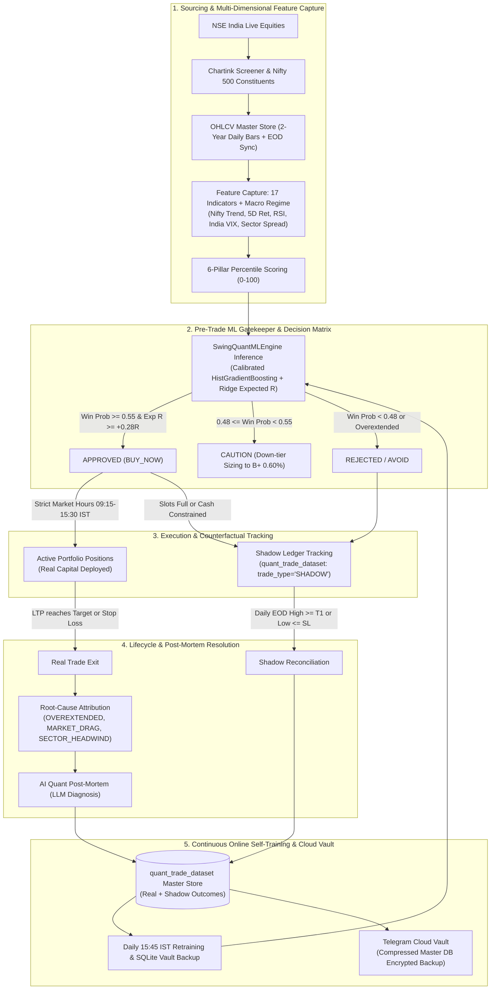

# Quant Trading Desk — Institutional Swing Trading & Quantitative ML Platform

[](https://www.python.org/downloads/)
[](https://fastapi.tiangolo.com/)
[](https://scikit-learn.org/)
[](https://www.nseindia.com/)
[](#)

Institutional-grade automated swing trading platform and quantitative portfolio management engine engineered specifically for the **National Stock Exchange of India (NSE)**.

The platform combines multi-factor technical screening, macro market regime conditioning, a **calibrated pre-trade Machine Learning gatekeeper**, **shadow counterfactual tracking** (eliminating survivorship bias), **AI LLM post-mortem diagnostics**, and **strict immutability capital gates**.

---

## Table of Contents
1. [End-to-End System Architecture](#1-end-to-end-system-architecture)
2. [Dual Quantitative Swing Portfolios](#2-dual-quantitative-swing-portfolios)
3. [Closed-Loop Quant ML & AI Feedback Engine](#3-closed-loop-quant-ml--ai-feedback-engine)
4. [Position Sizing, Risk Management & Target Mechanics](#4-position-sizing-risk-management--target-mechanics)
5. [Strict Immutability & Capital Protection Gates](#5-strict-immutability--capital-protection-gates)
6. [Single Master Vault & Telegram Cloud Synchronization](#6-single-master-vault--telegram-cloud-synchronization)
7. [Daily Automated Execution Timeline (IST)](#7-daily-automated-execution-timeline-ist)
8. [Comprehensive REST API Reference](#8-comprehensive-rest-api-reference)
9. [Local Development & Cloud Deployment](#9-local-development--cloud-deployment)

---

## 1. End-to-End System Architecture



---

## 2. Dual Quantitative Swing Portfolios

The platform operates two distinct, mathematically isolated swing trading portfolios:

| Parameter | Portfolio 1: Institutional 6-Pillar Swing | Portfolio 2: Nifty 500 Momentum Compounded |
| :--- | :--- | :--- |
| **Target Universe** | Chartink fundamentally screened liquid mid/large caps | Official Nifty 500 constituents |
| **Capital Allocation** | ₹5,00,000 base capital | ₹1,00,000 base with dynamic equity compounding |
| **Max Capacity** | 10 slots (max 2 positions per sector) | 10 slots (10% allocation cap per slot) |
| **Risk per Trade** | Tiered: 1.00% (A+), 0.75% (A), 0.60% (B+) | 1.50% of live compounded equity |
| **Core Entry Filter** | 6-Pillar percentile rank + ML Gatekeeper approval | 7-point technical & macro regime matrix |
| **Stop Loss Model** | $\min(\text{Low}_{20d}, \text{Entry} - 1.5\times\text{ATR}_{14})$ (hard cap 8%) | $2.0\times\text{ATR}$ Wilder volatility stop |
| **Target Strategy** | T1 = +1.5R (book 50%, BE trail), T2 = +3.0R | 4-Tier Strategy: Initial SL, 5D Low @ +2R, < 20 EMA, 8-Day time exit |
| **Execution Times** | 10:20 AM IST (Morning) & 3:00 PM IST (Afternoon) | 3:00 PM IST (Market-On-Close) |

### Portfolio 1: The 6-Pillar Percentile Model
Every candidate is ranked across six independent statistical dimensions against the liquid universe:
1. **Pillar 1 — Trend Structure (25%)**: Alignment of 20, 50, and 200 EMAs; Stage 2 breakout validation.
2. **Pillar 2 — Momentum Impulse (20%)**: RSI(14) positioning (50–70 sweet spot), MACD histogram acceleration, ADX trend strength.
3. **Pillar 3 — Volatility Contraction (15%)**: Volatility Contraction Pattern (VCP) detection, Bollinger Band squeeze ratio.
4. **Pillar 4 — Institutional Volume (15%)**: Relative Volume (RVOL), accumulation days count, pocket pivot footprint.
5. **Pillar 5 — Relative Strength Spread (15%)**: 6-month benchmark alpha and real sector excess momentum spread.
6. **Pillar 6 — Pivot Proximity (10%)**: Distance to 50-day pivot high, consolidation base tightness.

---

## 3. Closed-Loop Quant ML & AI Feedback Engine

Technical screening alone evaluates a static snapshot in isolation, ignoring broader market regimes, sector rotation, and overextension risks. The **Closed-Loop Quant ML & AI Engine** (`engines/swing_quant_ml_engine.py`) provides end-to-end feedback learning:

```
Candidate Setup ──► Pre-Trade ML Gatekeeper ──► [Approved] ──► Active Real Capital
                           │
                           └──► [Rejected] ──► Shadow Ledger ──► EOD Audit ──► Retrain ML
```

### 1. Pre-Trade Multi-Dimensional Feature Capture
At candidate evaluation, a 17-feature vector is captured and recorded into `quant_trade_dataset`:
- **Micro Technical Features**: `score`, `confidence`, `rsi14`, `atr_pct`, `dist_to_pivot`, `dist_to_ema20`, `vol_ratio`, `inst_score`, `week_confluence`, `is_vcp`, `bb_sq_ratio`, `adx14`, `rr_ratio`.
- **Macro Market Regime Features**: `nifty_trend` (Bullish/Bearish/Sideways), `nifty_ret_5d` (5-day index return), `nifty_rsi14`, `vix_val` (India VIX spot), `sector_excess_6m` (sector 6-month relative momentum).

### 2. Calibrated Pre-Trade ML Gatekeeper
- **Model Architecture**: `HistGradientBoostingClassifier` combined with 3-fold probability calibration (`CalibratedClassifierCV(method='sigmoid')`) + `Ridge` regressor for Expected R-Multiple.
- **Expected R Formula**:
  $$\mathbb{E}[R] = P(\text{Win}) \times \left(\frac{T_1 - \text{Entry}}{\text{Entry} - \text{SL}}\right) - (1 - P(\text{Win})) \times 1.0$$
- **Decision Matrix**:
  - **`APPROVED`**: $P(\text{Win}) \ge 0.55$, $\mathbb{E}[R] \ge +0.28\text{R}$, zero fatal risk flags. Deployed to `BUY_NOW`.
  - **`CAUTION`**: $0.48 \le P(\text{Win}) < 0.55$. Sizing tier is capped at Tier B+ (0.60% risk).
  - **`REJECTED`**: $P(\text{Win}) < 0.48$, $\mathbb{E}[R] < 0.05\text{R}$, or overextension flags. Blocked from execution and routed to the Shadow Ledger.
- **Overextension Guardrails**:
  - `OVEREXTENDED_FROM_PIVOT`: $\text{dist\_to\_pivot} > 3.0\%$ (fatal if $> 4.5\%$).
  - `OVEREXTENDED_FROM_EMA20`: $\text{dist\_to\_ema20} > 5.0\%$ (fatal if $> 7.0\%$).
  - `RSI_OVERBOUGHT`: $\text{RSI}_{14} > 74.0$ (fatal if $> 82.0$).
  - `HIGH_VOLATILITY_VIX`: $\text{India VIX} > 18.0$.
  - `MARKET_REGIME_HEADWIND`: Nifty in Bearish trend or 5-day return $< -1.5\%$.
  - `WEAK_VOLUME`: Volume ratio $< 1.05\times$ 50-day average.

### 3. Shadow / Counterfactual Ledger (Zero Survivor Bias)
Rejected candidates or setups skipped due to full portfolio slots (10/10) or cash limits are **never discarded**. They are stored in `quant_trade_dataset` as `trade_type = 'SHADOW'`, `status = 'ACTIVE'`.
- Every day at **15:45 IST** (and on-demand via `/api/ml/swing/reconcile-shadow`), `reconcile_shadow_trades()` evaluates their actual daily OHLCV bars:
  - If Day's Low $\le$ Stop Loss: Marked `RESOLVED_STOP_LOSS` ($is\_winner = 0$). Confirms the ML gatekeeper was right to avoid the trade.
  - If Day's High $\ge$ Target: Marked `RESOLVED_TARGET` ($is\_winner = 1$). Identifies counterfactual missed winners.
  - If Hold Days $\ge 20$: Marked `EXPIRED_TIME` (time stop).
- Both real trades and shadow counterfactuals are fed into model training, providing completely unbiased data across winners and losers.

### 4. Algorithmic Root-Cause Attribution & AI Post-Mortem
When any trade exits (Real or Shadow), the system determines the primary mechanical driver:
- `OVEREXTENDED_AT_ENTRY (Chasing into resistance)`
- `MARKET_PULLBACK_DRAG (Nifty returned < -1.5% during hold)`
- `SECTOR_ROTATION_HEADWIND (Sector lagging benchmark by > 3.5%)`
- `LOW_VOLUME_FALSE_BREAKOUT (Lack of institutional follow-through)`
- `TARGET_ACHIEVED_CLEAN_EXPANSION`
- `NORMAL_STATISTICAL_STOP_OUT`

The system then prompts the integrated AI engine (Groq / OpenRouter LLM) to synthesize a concise, quantitative diagnosis explaining the micro/macro dynamics and extracting lessons for future filtering.

---

## 4. Position Sizing, Risk Management & Target Mechanics

Position sizing is mathematically derived from volatility, structural risk, and capital availability:

```
Capital Budget & Risk Tier
         │
         ▼
Structural Stop Loss (20d Low & ATR) ──► Risk Per Share (Entry - SL)
                                                 │
                                                 ▼
Concentration Caps (20% Max, 3% Min) ◄── Share Sizing: floor(Risk / R_share)
```

### 1. Capital Allocation & Risk Tiers
- **Portfolio 1 Base Capital ($C$)**: ₹5,00,000.
- **Risk Budget per Trade**:
  - **Tier A+** (Score $\ge 90.0$, Confidence $\ge 5$, ML = `APPROVED`): **1.00% Risk** = **₹5,000** risk budget.
  - **Tier A** (Score $\ge 80.0$, Confidence $\ge 4$, ML = `APPROVED`): **0.75% Risk** = **₹3,750** risk budget.
  - **Tier B+** (Score $\ge 70.0$ or ML = `CAUTION`): **0.60% Risk** = **₹3,000** risk budget.

### 2. Stop Loss Derivation
The Stop Loss is anchored to market structure and volatility:
$$\text{Structure SL} = \min\left(\text{Low}_{20d},\; \text{Entry} - 1.5 \times \text{ATR}_{14}\right)$$
$$\text{Hard Cap SL} = \text{Entry} \times 0.92 \quad (\text{Maximum } 8\% \text{ allowable risk})$$
$$\text{Stop Loss} = \max\left(\text{Structure SL},\; \text{Hard Cap SL}\right)$$

### 3. Share Quantity Formula
$$\text{Risk Per Share } (R_{\text{share}}) = \text{Entry} - \text{Stop Loss}$$
$$\text{Shares} = \left\lfloor \frac{\text{Risk Budget}}{R_{\text{share}}} \right\rfloor$$

### 4. Capital Exposure & Concentration Limits
1. **Max Position Value (20% Cap)**: No single holding may exceed 20% of portfolio capital (max ₹1,00,000 per stock in P1):
   $$\text{If } (\text{Shares} \times \text{Entry}) > 0.20 \times C \implies \text{Shares} = \left\lfloor \frac{0.20 \times C}{\text{Entry}} \right\rfloor$$
2. **Min Position Value (3% Cap)**: If $(\text{Shares} \times \text{Entry}) < 0.03 \times C$ (₹15,000) or $\text{Shares} < 5$, the trade is discarded (0 shares).
3. **Available Cash Gate**:
   $$\text{Available Cash} = C + \text{Realized PnL} + \text{Booked T1 PnL} - \text{Total Invested}$$
   If $(\text{Shares} \times \text{Entry}) > \text{Available Cash}$, order placement is blocked.

### 5. Target Execution & Trailing Strategy
- **Target 1 ($T_1 = \text{Entry} + 1.5 \times R$)**: 
  When price reaches $T_1$, the engine automatically sells **50% of the position** to secure gains, and immediately ratchets the Stop Loss on the remaining 50% shares to **Breakeven ($\text{Entry}$)**.
- **Target 2 ($T_2 = \text{Entry} + 3.0 \times R$)**: 
  The remaining 50% position runs toward $T_2$ with a trailing stop anchored to the 10-day EMA, achieving a composite **1:3.0 Risk-to-Reward profile**.

---

## 5. Strict Immutability & Capital Protection Gates

To guarantee that active capital and historical records can never be compromised by automated scans, background routines, or code changes, the platform implements **four strict immutability gates**:

### Gate 1: Strict Trading Hours Invariant (`NSEMarketCalendar`)
- **Active Window**: Monday through Friday, **09:15 AM to 03:30 PM IST** (excluding official NSE holidays).
- **Enforcement**: Order execution and reconciliation are strictly blocked outside trading hours unless explicitly passed with `bypass_gate=True` by user command.

### Gate 2: Authorization Token Lockdown (`reset_portfolio_trades`)
- `POST /api/portfolio/reset` and `state_engine.reset_portfolio_trades()` are permanently protected.
- Any request without the explicit authorization token:
  ```json
  { "confirm_token": "CONFIRM_USER_AUTHORIZED_RESET" }
  ```
  is hard-blocked with `HTTP 200 BLOCKED`. Active positions and trade history can never be wiped accidentally.

### Gate 3: Active Position Immutability (`open_position`)
- If a stock is already open in `active_positions`, subsequent scans or triggers strictly skip it.
- **Invariant**: Entry price, quantity, and entry date are permanently write-once and can never be mutated by a new scan.

### Gate 4: Ratchet Stop Loss Invariant (`update_position_price`)
- During price stream updates, stop loss adjustments enforce a strict one-way ratchet:
  $$\text{Effective SL} = \max(\text{Current SL},\; \text{New SL})$$
- Stop losses can only tighten (move upward); they can **never** be loosened or lowered.

### Gate 5: Historical Chart Depth Preservation & Auto-Gapfill
- **Invariant**: Real-time tick streams and short deltas ($<80$ bars) are strictly forbidden from truncating historical depth in `ohlcv_master_store`.
- If an incoming DataFrame has fewer bars than the existing cached history, `save_ohlcv_batch()` and `save_ohlcv_df()` automatically stitch and merge the incoming bars onto the deep historical series rather than overwriting it.
- If any stock in `ohlcv_master_store` or requested via `/api/stocks/{symbol}/chart` has $<80$ bars, the engine automatically fetches the full 2-year OHLCV history ($260$ daily trading bars) from Yahoo Finance and updates the master database immediately.

---

## 6. Single Master Vault & Telegram Cloud Synchronization

All system state is consolidated into **one single SQLite file** (`data/swing_trades.db`):
- `active_positions`: Currently open holdings with full IST entry timestamps.
- `trade_history`: Immutable closed trade records with realized PnLs and R-multiples.
- `quant_trade_dataset`: Master ML dataset tracking real and shadow trades.
- `latest_signals`: Snapshot of current screen setups.
- `ohlcv_master_store`: 2-year daily OHLCV bars + technical summaries for all 800+ stocks.
- `system_kv_store`: ML model bundles, Nifty 50 predictions, and system configurations.

### Real-Time Telegram Cloud Backup & Cold-Boot Auto-Restore
- Operates in `journal_mode=DELETE` (zero sidecar `.db-wal` or `.db-shm` files on disk).
- On every trade event (`TRADE_OPEN`, `TRADE_CLOSE`, or daily scan), the master file is compressed (`quant_master_vault.db.gz`) and uploaded to a private Telegram Cloud Vault via Bot API.
- On container cold-boot (e.g. Render restart), `telegram_vault.auto_restore_on_cold_boot()` downloads the latest compressed vault, verifies its SHA-256 integrity, and restores database state seamlessly.

---

## 7. Daily Automated Execution Timeline (IST)

```
08:50 AM ──► Official Pre-Market Forecast Lock & Telegram Bulletin
08:55 AM ──► NSE Dynamic Holiday Calendar Sync
09:00 AM ──► Render Anti-Sleep Keepalive Guard Activates (Pings every 4m)
09:15 AM ──► NSE Market Opening & Strict Trading Gate Opens
10:20 AM ──► Morning Intraday Scan & Portfolio 1 Rebalancing
03:00 PM ──► Afternoon MOC Swing Scan (Portfolio 1 & Portfolio 2)
03:30 PM ──► NSE Market Close & Strict Trading Gate Closes
03:45 PM ──► Daily Quant ML Retraining, Shadow Reconciliation & Cloud Vault Backup
03:50 PM ──► Render Anti-Sleep Keepalive Guard Deactivates
```

---

## 8. Comprehensive REST API Reference

### System & Health Endpoints
| Endpoint | Method | Description |
| :--- | :--- | :--- |
| `/health` | `GET` | Health check probe for container runners (Render keepalive). |
| `/api/status` | `GET` | Live IST clock, market open/closed status, next scheduled jobs, engine status. |
| `/api/calendar` | `GET` | Official NSE trading calendar and upcoming market holidays. |

### Portfolio & Position Management
| Endpoint | Method | Description |
| :--- | :--- | :--- |
| `/api/portfolio/{type}/summary` | `GET` | Realized PnL, unrealized PnL, win rate, profit factor, R-expectancy. |
| `/api/portfolio/{type}/positions` | `GET` | Open active positions with real-time MTM prices, return %, and stop distance. |
| `/api/portfolio/{type}/history` | `GET` | Immutable closed trade history with realized PnL, R-multiple, and exit reasons. |
| `/api/portfolio/{type}/signals` | `GET` | Screened candidate setups with 6-pillar breakdown, ML prob, and sizing tier. |
| `/api/position/close` | `POST` | Manually close an active position (`symbol`, `exit_price`, `exit_reason`). |
| `/api/portfolio/reset` | `POST` | Reset portfolio trades (**Requires** `confirm_token="CONFIRM_USER_AUTHORIZED_RESET"`). |

### Quant ML & Shadow Ledger Endpoints
| Endpoint | Method | Description |
| :--- | :--- | :--- |
| `/api/ml/swing/model-status` | `GET` | Model sample count, Brier calibration score, empirical win rate, gatekeeper criteria. |
| `/api/ml/swing/train` | `POST` | Triggers immediate on-demand online training for ML classifier and regressor. |
| `/api/ml/swing/dataset` | `GET` | Retrieves master dataset records (`trade_type`: `REAL`, `SHADOW`, or `ALL`). |
| `/api/ml/swing/shadow-trades` | `GET` | Retrieves all active shadow setups being monitored counterfactually. |
| `/api/ml/swing/reconcile-shadow`| `POST` | Triggers on-demand reconciliation of active shadow trades against EOD bars. |

### Scans & Master Vault
| Endpoint | Method | Description |
| :--- | :--- | :--- |
| `/api/scan/trigger` | `POST` | Triggers background scan (`MORNING_1020AM`, `AFTERNOON_300PM`, `INSTITUTIONAL_P1`, `NIFTY500_P2`). |
| `/api/scan/progress` | `GET` | Real-time scan execution stage, percentage, and live logs. |
| `/api/stocks/{symbol}/chart` | `GET` | 260-bar daily OHLCV candlestick payload with trade lines (Entry, SL, T1, T2). |
| `/api/vault/status` | `GET` | Telegram Cloud Vault backup timestamps, file ID, and file size. |
| `/api/vault/sync` | `POST` | Manually triggers compressed master database backup to Telegram Cloud. |

---

## 9. Local Development & Cloud Deployment

### Local Setup
```bash
# 1. Clone repository
git clone https://github.com/satishreddy07/nse-tradingdesk.git
cd nse-tradingdesk

# 2. Create and activate virtual environment
python -m venv venv
# Windows:
venv\Scripts\activate
# Linux/macOS:
source venv/bin/activate

# 3. Install dependencies
pip install -r requirements.txt

# 4. Launch web application and automated scheduler
python main.py
```
Open browser to: **`http://localhost:8000`**

### Running Test Suite
```bash
pytest
```
*Current test suite: 60/60 passing unit & integration tests.*

### Cloud Deployment (Render)
1. Connect GitHub repository to [Render Dashboard](https://dashboard.render.com/).
2. Select **Web Service**, Region: **Singapore** (`ap-southeast-1`).
3. Set Build Command: `pip install -r requirements.txt`
4. Set Start Command: `uvicorn web.api:app --host 0.0.0.0 --port $PORT`
5. Configure Environment Variables:
   - `TZ` = `Asia/Kolkata`
   - `TELEGRAM_BOT_TOKEN` = `your_bot_token`
   - `TELEGRAM_CHAT_ID` = `your_chat_id`
   - `GROQ_API_KEY` = `your_groq_key` (optional for LLM post-mortems)
   - `OPENROUTER_API_KEY` = `your_openrouter_key` (optional for LLM post-mortems)
6. Deploy service. The background keepalive guard will keep the service awake during NSE market hours automatically.
