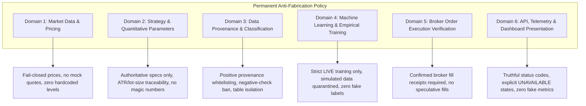
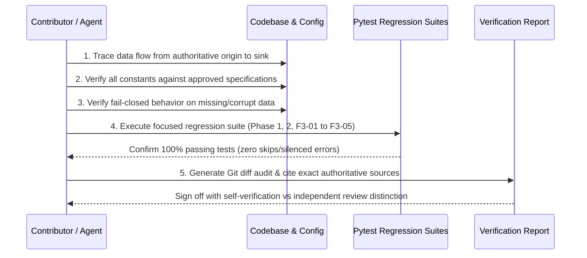

# NSE Trading Desk — Permanent Anti-Fabrication Policy

**Document Version**: 1.0.0  
**Effective Date**: Permanent Project Standard (October 2026 onwards)  
**Authority**: Mandatory Governance Standard for the NSE Trading Desk  
**Applicability**: All modules, services, engines, pipelines, APIs, databases, tests, and human/agent contributors.

---

## 1. Executive Summary & Core Principle

The NSE Trading Desk executes real-time quantitative analysis, machine learning prediction, and automated execution in live capital markets. In financial software, **an unhandled error is infinitely preferable to a fabricated result**. 

### The Fundamental Rule
> **Data integrity, financial calculation accuracy, and strict preservation of authentic market observation take absolute priority over uptime, execution speed, model availability, or user-interface completeness.**
>
> Never invent, assume, approximate, or silently substitute a market price, OHLCV candle, option Greek, trade parameter, position multiplier, probability score, backtest metric, or execution confirmation. When authoritative data is missing, the system must fail closed with explicit unavailable telemetry.

---

## 2. Policy Scope & System Boundaries

This policy governs six critical functional domains across the repository:



Compliance with this policy is mandatory. No agent, developer, or automated process is authorized to bypass these rules under any circumstance.

---

## 3. Domain 1: Prevention of Fabricated Financial Values

### 3.1 Live Market Data & Pricing
1. **Authentic Source Requirement**: All live spot prices, option prices, futures prices, OHLCV candles, volume data, and order-book depths must originate exclusively from configured, authorized market data providers (e.g., Kotak Neo API, NSE official exchange feeds).
2. **Prohibition of Static Defaults**: Never hardcode fallback prices (such as `22600.0`, `22800.0`, or `22811.0`). If live ticks or snapshots are unavailable, the function must return `None` or an explicit dictionary containing `{"status": "DATA_UNAVAILABLE"}`.
3. **Temporal Freshness & Staleness**: Every price quote must preserve its original exchange timestamp. Data must never be described as "live" if it exceeds latency thresholds or represents a cached/historical observation.
4. **Zero Random or Sample Generation**: Generating random prices, synthetic OHLCV bars, interpolated option chains, or mock order books in production code paths is strictly prohibited.

### 3.2 Derivatives Calculations & Greeks
1. **No Synthetic Quotes in Live Execution**: When calculating option strategies, leg roll-overs, or dynamic adjustments (e.g. Iron Fly or Broken Wing Butterfly adjustments in `strategy_adjustment_engine.py`), pricing must use live quotes. Substituting Black-Scholes-Merton (BSM) theoretical prices when broker quotes fail is strictly forbidden.
2. **Deterministic Inputs**: Volatility (IV), Greek calculations (Delta, Gamma, Theta, Vega), and Put-Call Ratios (PCR) must derive strictly from empirical strikes and verified price quotes. Missing quotes must cause calculation deferral, not heuristic estimation.

---

## 4. Domain 2: Elimination of Unsupported Hardcoded Defaults & Parameters

### 4.1 Parameter Classification Standard
Every numeric literal introduced into trading, financial, risk-management, or analytics logic must be formally categorized into one of six classes:

| Class | Description | Policy Status | Governance Requirement |
| :--- | :--- | :--- | :--- |
| **Mathematical / Technical Constant** | Fundamental identities (e.g., $\sqrt{2/\pi}$, 100.0 for percentages, 375 minutes in trading day, seconds in hour). | **Permitted** | Document mathematical derivation in inline docstring. |
| **Protocol / API Specification** | Fixed by exchange or broker protocol (e.g., tick size of 0.05, price steps). | **Permitted** | Reference protocol specification and document origin. |
| **Approved Strategy Parameter** | Capital risk limits, target multipliers, lookback horizons explicitly approved by design. | **Permitted** | Traceable to `core/config.py` or authorized strategy specification. |
| **Operational Setting** | Cache TTLs, socket timeout limits, watchdog polling intervals. | **Permitted** | Confined to operational configuration files with clear justification. |
| **Test Fixture** | Fixed inputs used strictly in test files to verify deterministic edge cases. | **Permitted** | Strictly isolated within `tests/` directories; forbidden from production imports. |
| **Unverified / Arbitrary Value** | Heuristic thresholds, invented stop-loss percentages, fabricated sizing multipliers. | **PROHIBITED** | Must be rejected, removed, or escalated for authoritative resolution. |

### 4.2 Authoritative Sources of Truth
- **Lot Sizes**: Must use the authoritative circular-compliant schedule and instrument-master resolver (`core/lot_size.py`). Hardcoding lot sizes (e.g. assuming NIFTY is always 50, 25, 75, or 65) is strictly forbidden.
- **Position Sizing & ATR Multipliers**: Multipliers (e.g. ATR risk multipliers in `institutional_engine.py`) must originate from approved strategy configuration. If ATR or stop-loss distance is missing or non-positive, position sizing must fail closed (returning 0 shares/contracts).
- **Strike Selection**: Strike intervals and dynamic band multipliers must follow NSE contract specifications and verified underlying spot prices.

---

## 5. Domain 3: Data Provenance & Explicit Whitelisting

### 5.1 Provenance Taxonomy
All market data, snapshots, and operational records stored in databases or transmitted across engines must carry an explicit, immutable `data_source` label:

```
┌────────────────────────────────────────────────────────────────────────┐
│                        DATA PROVENANCE TAXONOMY                        │
├─────────────────────────┬──────────────────────────────────────────────┤
│ LIVE                    │ Genuine, real-time observation from broker/  │
│                         │ exchange API during market hours.            │
├─────────────────────────┼──────────────────────────────────────────────┤
│ HISTORICAL_SOURCED      │ Authenticated historical records sourced     │
│                         │ from authoritative exchange archives.        │
├─────────────────────────┼──────────────────────────────────────────────┤
│ UNVERIFIED_HISTORICAL   │ Legacy rows whose provenance cannot be       │
│                         │ verified with cryptographic/feed evidence.   │
├─────────────────────────┼──────────────────────────────────────────────┤
│ SIMULATED               │ Synthetic or simulated data generated during │
│                         │ backtests, stress testing, or paper trades.  │
├─────────────────────────┼──────────────────────────────────────────────┤
│ SYNTHETIC_GAPFILL       │ Interpolated/manufactured records created by │
│                         │ legacy gapfill routines. Quarantined.        │
└─────────────────────────┴──────────────────────────────────────────────┘
```

### 5.2 Whitelist Enforcement & Negative-Check Prohibition
1. **Positive Whitelisting Mandatory**: Code querying empirical market data must explicitly filter on `WHERE data_source = 'LIVE'` (or `'HISTORICAL_SOURCED'` where approved).
2. **Prohibition of Negative Checks**: Never assume a record is authentic merely because it lacks a synthetic marker. Query filters such as:
   ```sql
   -- PROHIBITED: Negative check (assumes missing marker implies genuine data)
   WHERE snapshot_json NOT LIKE '%AUTO_GAPFILL%'
   
   -- MANDATORY: Positive provenance check
   WHERE data_source = 'LIVE'
   ```
   are strictly banned from serving as the sole authentication filter.
3. **Fail-Closed on Unmigrated Databases**: If a database table lacks the `data_source` column, the reader must fail closed (returning `DATA_UNAVAILABLE` or empty collections) rather than treating legacy records as authentic.

---

## 6. Domain 4: Strict Isolation of Synthetic Data from Empirical Training

### 6.1 Database Quarantine
1. **Physical Table Isolation**: Synthetic, theoretical, and simulated data must never be written to tables designated for empirical market observation.
   - Empirical snapshots: `intraday_option_snapshots` (accepts only `LIVE` and historical observations).
   - Simulation records: `simulated_option_snapshots` (quarantined isolated table).
2. **No Silent Re-labeling**: Old or unverified records must never be relabeled as `LIVE` without verifiable audit evidence from exchange transaction logs.

### 6.2 Machine Learning & Forecast Calibration
1. **Empirical Training Integrity**:
   - `intraday_ml_engine.py`: Online training transitions must load exclusively records where `data_source = 'LIVE'`.
   - `nifty_forecast_learning_engine.py`: PCR calibration and feature extraction must query only `data_source = 'LIVE'`.
   - `nifty_analytics_engine.py` (`train_and_predict_nifty_future`): Daily bias options PCR maps must accept only `data_source = 'LIVE'`.
2. **Zero Fabricated Model Outputs**:
   - Machine learning engines must never manufacture training records, labels, prediction outcomes, evaluation metrics, or performance statistics.
   - If an ML model fails inference or lacks sufficient training transitions, it must return an explicit `DATA_UNAVAILABLE` status and reason, falling back only to mathematically approved analytical priors (e.g. pure Bayesian flow priors) with explicit notification.

---

## 7. Domain 5: Authentic Broker Order Execution Verification

### 7.1 Prohibition of Speculative Execution Claims
1. **No Presumed Execution**: An order or strategy leg must never be marked as `CLOSED`, `FILLED`, or `EXECUTED` based merely on:
   - Successful dispatch of an HTTP request to the broker API.
   - Elapsed timer, sleep duration, or timeout.
   - Local strategy adjustment calculations.
   - Paper-trading simulation assumptions.
2. **Broker Fill Confirmation Mandatory**: State transitions to `CLOSED` or `FILLED` in execution daemons (`autonomous_execution_daemon.py`, `strategy_adjustment_engine.py`) require authentic verification:
   - A confirmed fill response from the broker containing an authentic order ID, fill price, and fill quantity; OR
   - Explicit verification against the broker's order book / trade book via authenticated query.

### 7.2 Handling Failure and Indeterminate States
1. **Preserve Open State**: If order placement fails, throws an exception, encounters a network timeout, or receives an error code, the strategy leg must remain in its open state (`ACTIVE` or `PENDING_BROKER_CONFIRMATION`).
2. **Partial Fills**: Partial broker fills must update only the matched quantity. The remaining position must remain open until explicitly confirmed or cancelled.
3. **Audit Trail**: Every state transition must log the broker's authoritative order reference, timestamp, execution quantity, and price.

---

## 8. Domain 6: API, UI & Telemetry Integrity

1. **Truthful Telemetry**: Watchdogs (`data_watchdog.py`, `omni_watchdog_engine.py`) must evaluate stream latency, age, and packet freshness strictly against `data_source = 'LIVE'` records.
2. **No Dashboard Placeholders**: Production API endpoints (`/api/...`) must never return hardcoded financial metrics, mock account balances, or placeholder win rates.
3. **Explicit Error Representation**: When data is unavailable, REST responses must carry explicit indicators:
   ```json
   {
     "status": "DATA_UNAVAILABLE",
     "message": "Authentic option quotes unavailable for strike 22500; refusing synthetic substitution.",
     "data": null
   }
   ```
4. **Separation of Demo / Paper Data**: Any simulated or paper-trading telemetry must be explicitly badged in both API payloads (`"is_simulated": true`) and UI views (`badge: SIMULATION`).

---

## 9. Implementation Status: Documented vs. Automated Enforcement

To maintain engineering transparency, the table below distinguishes policies currently documented versus those enforced by automated code gates:

| Policy Requirement | Documented Specification | Automated Runtime / CI Enforcement | Status / Gap Analysis |
| :--- | :---: | :---: | :--- |
| **Zero Hardcoded Prev Close & Spot Fallbacks** | Section 3.1 | **Enforced** in `tests/test_phase1_data_integrity.py` | Complete. Hardcoded fallbacks removed from analytics and options edge engines. |
| **Authentic Volume Profile & Value Area** | Section 3.1 | **Enforced** in `tests/test_phase2_data_integrity.py` | Complete. Validated against genuine candles with fail-closed checks. |
| **Empirical SL/Reentry Matrix (No Synthetic Priors)** | Section 4.2 | **Enforced** in `tests/test_phase2_data_integrity.py` | Complete. Synthetic priors rejected when trade history is insufficient. |
| **Broker Execution Confirmation (F3-01)** | Section 7.1 | **Enforced** in `tests/test_f301_autonomous_execution_integrity.py` | Complete. Legs remain open on missing interface, timeout, or broker error. |
| **Authoritative ATR Position Sizing (F3-02)** | Section 4.2 | **Enforced** in `tests/test_f302_institutional_sizing_integrity.py` | Complete. Non-positive/missing ATR fails closed returning 0 shares. |
| **NSE Circular-Compliant Lot Sizes (F3-03)** | Section 4.2 | **Enforced** in `tests/test_f303_nifty_lot_size_integrity.py` | Complete. Circular transition dates (50 → 25 → 75 → 65) verified with strict ambiguity rejection. |
| **Live Option Quotes Required in Adjustments (F3-04)** | Section 3.2 | **Enforced** in `tests/test_f304_strategy_adjustment_pricing_integrity.py` | Complete. BSM fallback substitution eliminated; adjustments defer safely on missing quotes. |
| **Snapshot Provenance Whitelist (`data_source = 'LIVE'`) (F3-05)** | Section 5.1 & 6.2 | **Enforced** in `tests/test_f305_synthetic_snapshots_integrity.py` | Complete. Provenance matrix enforced across ML training, forecast learning, watchdogs, and spot fallbacks. |
| **Simulation Table Isolation (`simulated_option_snapshots`)** | Section 6.1 | **Enforced** in `tests/test_f305_synthetic_snapshots_integrity.py` | Complete. Auto-gapfill writes strictly to simulation table. |
| **Automated AST Static Lint for Magic Numbers** | Section 4.1 | *Documented, Not Yet Automated in Pre-Commit* | **Enforcement Gap**: Requires custom AST linter in CI to catch undeclared numeric literals in PR diffs. |
| **Database Check Constraints for `data_source`** | Section 5.1 | *Enforced at Application Layer; SQLite Check Missing* | **Enforcement Gap**: Application code enforces provenance, but SQLite table schema lacks `CHECK(data_source IN (...))` constraint. |
| **Broker Trade Book Reconciliation Re-Audit** | Section 7.1 | *Enforced in Daemon Unit Tests; Periodic Live Sync Gap* | **Enforcement Gap**: Execution daemon checks responses, but periodic reconciliation against broker REST trade-book during disconnections needs automation. |

---

## 10. Verification Protocol Before Any Change

Before submitting any code change affecting financial data, quantitative parameters, ML models, or execution logic, contributors must execute the following protocol:



---

## 11. Concluding Governance Directive

Writing and publishing this policy does **not** by itself guarantee compliance. Compliance is guaranteed only through:
1. Continuous adherence by human developers and AI coding agents.
2. Mandatory execution of the automated regression test suites before every commit.
3. Peer review and verification of all git diffs against the rules documented herein.

Every contributor is personally accountable for upholding these data integrity standards.
